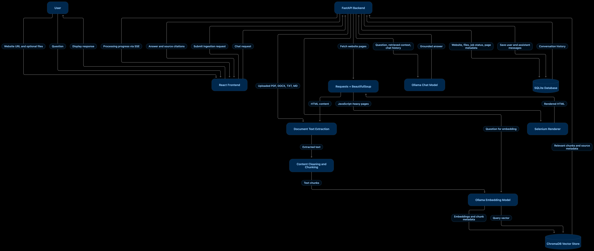
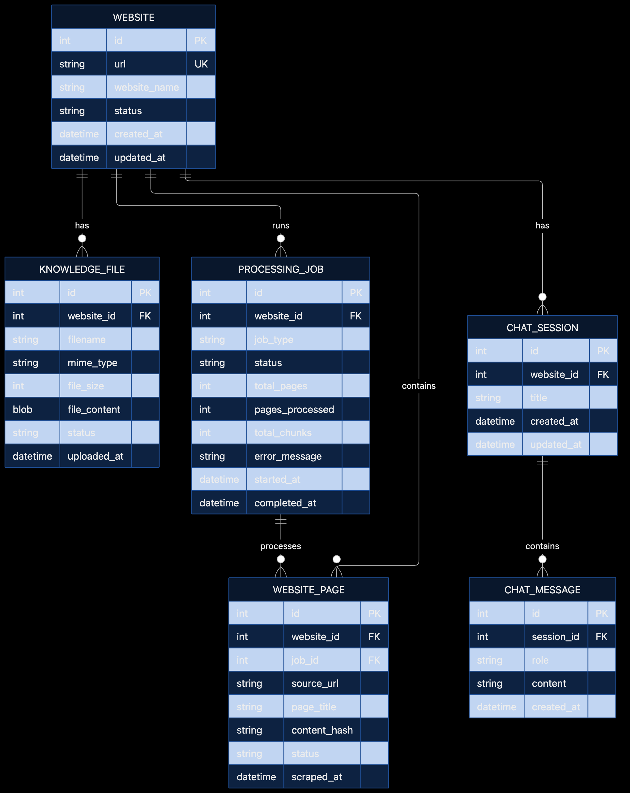
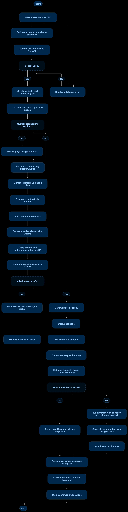

# 1. Project Overview

## 1.1 Project Title

**Website-Specific RAG Chatbot**

## 1.2 Project Objective

To develop a web application that allows users to provide a website URL and optionally upload additional knowledge-base documents. The system will extract and process the available content, index it for semantic retrieval, and provide a conversational interface that answers questions using the indexed knowledge and displays relevant source references.

## 1.3 Project Scope

The application will consist of two primary web pages:

**Page 1 — Website Ingestion**

- Accept a website URL from the user.
- Allow optional PDF, DOCX, TXT, and MD file uploads.
- Discover and scrape up to 100 pages from the provided website.
- Extract, clean, deduplicate, and chunk the collected content.
- Generate embeddings and store the processed chunks in a vector database.
- Display ingestion progress and processing errors.
- Redirect the user to the chat page after successful indexing.

**Page 2 — Conversational Chat Interface**

- Display the website or organization name as the chat title.
- Accept questions about the indexed website and uploaded documents.
- Retrieve relevant information using semantic search.
- Generate answers grounded in the retrieved context.
- Display source citations for the generated answers.
- Preserve conversation history across requests and page refreshes.

## 1.4 Initial Technical Decisions

- Frontend: React.js
- Backend: FastAPI and Pydantic
- Web scraping: Requests and BeautifulSoup
- JavaScript-rendered pages: Selenium when required
- Document extraction: PyMuPDF, python-docx, and Python text processing
- Text processing: Python and LangChain text splitters
- Embeddings: Ollama embedding model, with `nomic-embed-text` as an initial candidate
- Vector database: ChromaDB
- Relational database: SQLite
- LLM orchestration: LangChain
- Answer generation: Ollama chat model, selected through benchmarking
- Progress updates: Server-Sent Events (SSE)
- Testing: Pytest, Postman, Vitest, and React Testing Library
- Version control: Git and GitHub

The initial implementation will prioritize a locally runnable, maintainable application. Deployment and containerization are outside the current project scope.

# 2. Functional Requirements

## 2.1 Website Ingestion

- The system must accept a valid website URL.
- The system must support optional knowledge-base file uploads.
- The scraper must limit processing to a maximum of 100 website pages per ingestion job.
- The system must extract useful text from HTML pages and supported documents.
- The system must remove irrelevant content and duplicate information.
- The system must split content into manageable chunks and generate embeddings.
- The system must store the processed content and its source metadata.
- The system must report progress, failures, and completion status.

## 2.2 Conversational Retrieval

- The system must accept questions through a chat interface.
- It must retrieve relevant chunks from the selected website's knowledge base.
- It must use retrieved context when generating answers.
- It must provide source references for supported claims.
- It must avoid presenting unsupported information as verified website content.
- It must preserve the conversation history for subsequent questions.

## 2.3 Data Persistence

- Website information and processing status must persist in SQLite.
- Uploaded files must be stored according to the selected file-storage strategy.
- Chat sessions and messages must be stored in SQLite.
- Indexed text chunks, embeddings, and retrieval metadata must be stored in ChromaDB.
- Website-specific filtering must prevent one website's content from contaminating another website's answers.

## 2.4 Error Handling

- Invalid URLs and unsupported files must produce understandable errors.
- Failed page requests must be recorded without unnecessarily aborting the entire ingestion.
- Empty or unusable extracted content must be detected.
- Embedding, vector-storage, and LLM failures must be handled gracefully.
- If sufficient evidence is unavailable, the chatbot must communicate that limitation.

# 3. System Architecture and Technology Stack

## 3.1 Frontend

**Technology: React.js**

Responsibilities:

- Build the website-ingestion page and chat page.
- Collect URLs, files, and user questions.
- Display ingestion progress and errors.
- Render messages, loading indicators, and source citations.
- Communicate with FastAPI through HTTP requests.
- Consume SSE events for ingestion progress and, if implemented, streamed chat responses.

## 3.2 Backend API

**Technology: FastAPI with Pydantic**

Responsibilities:

- Expose endpoints for ingestion, chat, job status, and source retrieval.
- Validate request bodies, URLs, file types, and file sizes.
- Coordinate the scraping, extraction, embedding, retrieval, and generation workflows.
- Manage database operations and return structured responses.
- Stream ingestion progress to the frontend.

FastAPI will serve as the main coordination layer between the frontend, processing modules, databases, and language models.

## 3.3 Website Scraping

**Technologies: Requests, BeautifulSoup, and Selenium**

- Requests will fetch ordinary HTML pages.
- BeautifulSoup will parse HTML and extract relevant text, titles, and links.
- Selenium will render pages that depend on JavaScript when static fetching is insufficient.
- URL normalization and deduplication will prevent repeated processing of the same page.
- A page-discovery and crawling policy will enforce the 100-page limit and restrict crawling to the intended website scope.

Selenium will be used selectively rather than for every page, because rendering pages in a browser is generally more resource-intensive than fetching static HTML.

## 3.4 Document Processing

**Technologies: PyMuPDF, python-docx, and Python**

- PyMuPDF will extract text from PDF files.
- python-docx will extract text from DOCX files.
- Python text processing will handle TXT and MD files.
- The processing module will normalize whitespace, remove unnecessary boilerplate, detect duplicate content, and preserve useful source metadata.
- LangChain text splitters will divide extracted text into chunks suitable for embedding and retrieval.

Scanned PDFs may require an OCR capability, which can be added if scanned-document support is included in the final requirements.

## 3.5 Embedding Generation

**Technology: Ollama embedding model**

Initial candidate: `nomic-embed-text`.

Purpose:

- Convert each text chunk into a numerical vector representing its semantic content.
- Convert each user question into a query vector.
- Enable semantic matching between the question and indexed content.

The final embedding model will be selected after checking retrieval quality, processing speed, memory usage, and compatibility between document and query embeddings.

## 3.6 Vector Database

**Technology: ChromaDB**

Responsibilities:

- Store document chunks and their embeddings.
- Maintain the vector index used for similarity search.
- Store metadata such as website ID, source URL, source type, and chunk position.
- Retrieve the most relevant chunks for a user question.
- Filter retrieval results to the relevant website's knowledge base.

ChromaDB will be the retrieval store, while SQLite will hold the application's relational records.

## 3.7 Relational Database

**Technology: SQLite**

Responsibilities:

- Store website records and processing status.
- Store uploaded-file metadata.
- Track ingestion jobs and scraped-page metadata.
- Store chat sessions and conversation messages.
- Support persistent application state across requests and restarts.

Uploaded file bytes may be stored in SQLite using BLOB fields, or the application may store files on disk and save their paths in SQLite. This decision must be finalized before implementing the upload module.

## 3.8 LLM Orchestration and Answer Generation

**Technologies: LangChain and Ollama**

Responsibilities:

- Construct prompts using the user's question and retrieved context.
- Include relevant conversation history when appropriate.
- Invoke the selected chat model.
- Generate answers grounded in retrieved content.
- Format source references and handle cases where evidence is insufficient.

The chat model and embedding model serve different purposes. The embedding model supports semantic retrieval, while the chat model generates the final natural-language answer.

## 3.9 Progress and Streaming

**Technology: Server-Sent Events (SSE)**

SSE will allow the backend to send ingestion updates to the frontend, including:

- Job created.
- Pages discovered and processed.
- Documents extracted.
- Chunks generated.
- Embeddings stored.
- Indexing completed or failed.

SSE is a one-way stream from the server to the client. Normal HTTP requests will carry user input, while SSE will communicate progress. Token-by-token chat streaming can be added separately if required.

# 4. System Modules and Responsibilities

## Module 1 — Frontend and User Interface

- Build the ingestion and chat pages.
- Handle user input, file selection, validation feedback, and loading states.
- Display progress events, answers, and source citations.

## Module 2 — API and Request Validation

- Receive requests from React.
- Validate input through Pydantic schemas.
- Coordinate application modules.
- Return consistent success and error responses.

## Module 3 — Website Crawler

- Discover and fetch pages within the allowed website scope.
- Apply the 100-page limit.
- Identify pages requiring JavaScript rendering.
- Track failed and successfully fetched pages.

## Module 4 — Document Extraction and Cleaning

- Extract text from webpages and uploaded files.
- Normalize content and remove unnecessary material.
- Deduplicate content and preserve source identifiers.

## Module 5 — Chunking and Embeddings

- Split cleaned content into chunks.
- Generate document embeddings.
- Generate query embeddings using the same embedding model.
- Prepare chunks and metadata for indexing.

## Module 6 — Vector Indexing and Retrieval

- Insert chunks and embeddings into ChromaDB.
- Search for semantically relevant chunks.
- Apply website-level filters.
- Return retrieved text and source metadata.

## Module 7 — Chat and Answer Generation

- Receive user questions.
- Retrieve relevant context.
- Construct prompts and invoke the chat model.
- Generate grounded answers and source citations.
- Handle insufficient evidence.

## Module 8 — Database and Conversation Management

- Persist websites, files, jobs, and chat records.
- Retrieve conversation history.
- Associate each session with the correct website.
- Maintain consistent relationships between stored records.

## Module 9 — Progress, Logging, and Error Handling

- Report ingestion progress through SSE.
- Record processing failures and diagnostic information.
- Return useful error messages.
- Track completion status and support troubleshooting.

# 5. Database Design

## 5.1 Relational Database — SQLite

The initial relational schema will contain the following entities:

- **WEBSITE:** Website URL, name, status, and timestamps.
- **KNOWLEDGE_FILE:** Uploaded filename, file type, size, storage reference, and processing status.
- **PROCESSING_JOB:** Job type, status, page counts, chunk counts, and errors.
- **WEBSITE_PAGE:** Page URL, title, content hash, and scraping status.
- **CHAT_SESSION:** Website association, chat title, and timestamps.
- **CHAT_MESSAGE:** Session association, message role, content, and creation time.

Primary keys and foreign keys will enforce relationships between these entities. Website URLs may have a uniqueness constraint according to the application's reuse policy.

## 5.2 Vector Database — ChromaDB

Each indexed chunk should include:

- Chunk ID.
- Chunk text.
- Embedding vector.
- Website ID.
- Source type, such as webpage or uploaded file.
- Source identifier.
- Source URL or filename.
- Chunk position and other useful metadata.

The vector store is separate from the relational ERD. Its metadata will reference the relevant application records without relying on SQLite foreign-key enforcement.

# 6. API Design

The following is the proposed initial API surface. Exact request and response schemas will be finalized during API design.

| Method | Endpoint | Purpose |
|---|---|---|
| POST | `/websites` | Register a website for ingestion |
| POST | `/websites/{website_id}/ingest` | Start website and file processing |
| GET | `/jobs/{job_id}` | Retrieve ingestion status |
| GET | `/jobs/{job_id}/events` | Stream progress through SSE |
| GET | `/websites/{website_id}` | Retrieve website details |
| POST | `/websites/{website_id}/chat/sessions` | Create a chat session |
| GET | `/chat/sessions/{session_id}/messages` | Retrieve conversation history |
| POST | `/chat/sessions/{session_id}/messages` | Submit a question and receive an answer |
| GET | `/chat/messages/{message_id}/sources` | Retrieve source references for a response |

The ingestion endpoint may accept multipart form data containing the URL and uploaded files, depending on the final request design.

API responses should use consistent status codes and structured error messages. Long-running ingestion should be handled as a tracked job rather than forcing the initial HTTP request to remain open until processing finishes.

# 7. User Interface and Workflows

## 7.1 Page 1 — Website Ingestion

The page will contain:

- Website URL input.
- Optional knowledge-base file uploader.
- Submit button.
- Ingestion progress indicator.
- Current processing status.
- Validation and processing error messages.

**Workflow:** The user enters a URL and optionally uploads files. After validation, the backend creates an ingestion job and processes the content. The frontend receives progress updates and opens the chat page when indexing is complete.

## 7.2 Page 2 — Chat Interface

The page will contain:

- Website or organization name as the heading.
- Message history.
- Question input and send button.
- Loading or streaming indicator.
- Answer display.
- Expandable source citations or source links.
- Clear indication when the knowledge base does not contain sufficient evidence.

**Workflow:** The user submits a question. The backend generates a query embedding, retrieves relevant chunks, constructs a grounded prompt, invokes the chat model, stores the conversation, and returns the answer with its sources.

# 8. System Diagrams

The following three diagrams describe complementary aspects of the system. They should be saved as separate diagrams and included in the project documentation.

## 8.1 Data Flow Diagram (DFD)

**Purpose:** Shows how information moves between the user, frontend, backend processes, external models, and data stores.

**Explanation:** The DFD describes the movement of URLs, uploaded files, extracted text, chunks, embeddings, retrieved context, and generated answers. It shows how ingestion data reaches ChromaDB, how application records are stored in SQLite, and how user questions are transformed into retrieval requests. It also illustrates the return path for answers, citations, and progress updates to the React frontend. This diagram is useful for understanding system boundaries and data movement without focusing on individual implementation details.

## 8.2 Entity-Relationship Diagram (ERD)

**Purpose:** Defines the relational data model and the relationships between persistent application records.

**Explanation:** The ERD identifies the main database entities and their primary-key and foreign-key relationships. A website can have multiple uploaded files, processing jobs, scraped pages, and chat sessions. Each chat session can contain multiple messages, while a processing job can be associated with multiple scraped pages. ChromaDB remains a separate vector store; it holds embeddings and chunk metadata rather than functioning as a relational table in SQLite. The ERD guides database implementation and helps prevent inconsistent or duplicated application records.

## 8.3 Activity Diagram

**Purpose:** Describes the sequence of actions, decisions, and alternate outcomes throughout the application's workflow.

**Explanation:** The activity diagram follows the user journey from submitting a website URL and optional files through input validation, scraping, extraction, chunking, embedding generation, and indexing. It then shows the transition to the chat interface, query embedding, semantic retrieval, evidence checking, answer generation, citation attachment, and response display. Decision branches represent invalid input, unsuccessful indexing, and insufficient retrieval evidence. This diagram is useful for identifying missing workflow steps, error-handling requirements, and the conditions under which the application can proceed.

# 9. Implementation Roadmap

## Phase 1 — Requirements and Project Setup

- Finalize functional and non-functional requirements.
- Define the folder structure and module boundaries.
- Establish the Python environment and frontend setup.
- Configure Git and the initial repository.
- Finalize API contracts, database schema, and diagram versions.

**Deliverable:** Approved initial design and runnable project skeleton.

## Phase 2 — Database and API Foundation

- Define SQLite tables and relationships.
- Implement database initialization and persistence.
- Define Pydantic request and response schemas.
- Create basic FastAPI endpoints and error handling.
- Verify API behavior using Postman.

**Deliverable:** Working backend foundation with persistent application records.

## Phase 3 — Website Crawling and Document Extraction

- Implement URL validation and website-scoped crawling.
- Enforce the 100-page limit.
- Add Requests and BeautifulSoup extraction.
- Add Selenium for pages that require JavaScript rendering.
- Implement PDF, DOCX, TXT, and MD extraction.
- Add content cleaning, deduplication, and source tracking.

**Deliverable:** A reliable content-ingestion pipeline that produces clean text and source metadata.

## Phase 4 — Chunking, Embeddings, and Vector Indexing

- Configure the selected Ollama embedding model.
- Implement LangChain text splitting.
- Generate embeddings for processed chunks.
- Store chunks and metadata in ChromaDB.
- Implement website-scoped retrieval.
- Test retrieval relevance and processing performance.

**Deliverable:** An indexed knowledge base that supports semantic search.

## Phase 5 — RAG Chat and Citations

- Implement query embedding and retrieval.
- Construct prompts from retrieved context and conversation history.
- Integrate the selected Ollama chat model through LangChain.
- Add grounded response generation and insufficient-evidence handling.
- Attach source references to answers.
- Persist user and assistant messages.

**Deliverable:** A working RAG backend that answers questions using indexed knowledge.

## Phase 6 — Frontend Development

- Build the website-ingestion page.
- Implement file uploads and input validation feedback.
- Connect progress updates through SSE.
- Build the chat interface and message history.
- Display citations, errors, and loading states.
- Connect all frontend workflows to the backend APIs.

**Deliverable:** A usable two-page web application.

## Phase 7 — Testing and Evaluation

- Test individual backend modules using Pytest.
- Test endpoints and request validation using Postman.
- Test React components and user interactions using Vitest and React Testing Library.
- Evaluate retrieval relevance, answer grounding, citation correctness, and latency.
- Test failed page requests, unsupported files, empty content, and model errors.
- Verify persistence after application restarts and isolation between websites.

**Deliverable:** A tested application with documented limitations and evaluation results.

## Phase 8 — Final Integration and Documentation

- Run end-to-end ingestion and chat scenarios.
- Fix integration issues.
- Document installation and execution steps.
- Document API endpoints and environment configuration.
- Finalize the architecture diagrams.
- Organize the GitHub repository and project README.

**Deliverable:** A complete, locally runnable project with technical documentation.

# 10. Testing and Quality Strategy

Testing will cover both technical correctness and RAG answer quality.

- **Unit tests:** Validate individual scraping, extraction, cleaning, chunking, and database functions.
- **API tests:** Verify endpoints, request validation, error responses, and persistence.
- **Frontend tests:** Verify URL submission, file selection, progress display, chat interactions, and citations.
- **Integration tests:** Verify the complete ingestion-to-chat workflow.
- **Retrieval evaluation:** Check whether the expected source chunks appear among the retrieved results.
- **Generation evaluation:** Check factual grounding, answer relevance, citation accuracy, and unsupported claims.
- **Performance tests:** Measure ingestion time, embedding throughput, retrieval latency, and response time.

RAGAS may be considered as an optional evaluation framework. The initial evaluation can also use a manually reviewed set of questions with expected source documents and acceptable answers.

# 11. Non-Functional Requirements

- **Reliability:** Processing failures should be recorded and reported without unnecessarily losing successfully processed content.
- **Maintainability:** Scraping, processing, retrieval, generation, API, and persistence logic should remain modular.
- **Performance:** Static pages should use lightweight fetching, while browser rendering should be reserved for pages that need it.
- **Data isolation:** Retrieval must be scoped to the correct website and chat context.
- **Usability:** Progress and errors should be understandable to non-technical users.
- **Traceability:** Answers should provide useful source references whenever supporting evidence is available.
- **Security:** Validate uploaded files and URLs, restrict crawling to allowed targets, protect local services, and avoid exposing secrets.
- **Persistence:** Application records and conversation history should survive normal application restarts.

# 12. Initial Acceptance Criteria

The first complete version will be considered functionally ready when:

1. A user can submit a valid website URL and optionally upload supported documents.
2. The application processes no more than 100 website pages per ingestion job.
3. Extracted content is cleaned, chunked, embedded, and indexed successfully.
4. Ingestion progress and processing errors are visible to the user.
5. A user can ask questions through the chat interface.
6. Answers are generated using relevant retrieved context rather than relying solely on the LLM's general knowledge.
7. Source references identify the webpage or uploaded file supporting an answer.
8. The application communicates when sufficient supporting evidence cannot be found.
9. Chat history and application records persist across requests and normal restarts.
10. The system keeps the knowledge bases of different websites isolated.
11. The main ingestion and chat workflows pass the planned unit, API, frontend, and integration tests.

# 13. Key Design Decisions to Finalize Before Implementation

- Final embedding and chat models based on quality and performance tests.
- File storage strategy: SQLite BLOBs or filesystem paths.
- Website crawling rules, URL scope, and handling of robots.txt and rate limits.
- Chunk size, overlap, retrieval top-k, and similarity thresholds.
- Chat-session creation and history-management behavior.
- SSE event format and whether chat-token streaming is included.
- Whether scanned PDFs require OCR.
- Source citation format and minimum evidence requirements.

These decisions should be finalized during the relevant design or implementation phase rather than adding unnecessary complexity to the initial version.

# 14. Final Project Deliverables

- React frontend with ingestion and chat pages.
- FastAPI backend with validated APIs.
- Website crawler and document extraction pipeline.
- Content cleaning, deduplication, and chunking modules.
- Ollama embedding integration.
- ChromaDB vector indexing and retrieval.
- LangChain-based RAG generation pipeline.
- SQLite persistence and conversation history.
- Source citations and insufficient-evidence handling.
- SSE ingestion progress.
- Automated tests and RAG evaluation results.
- Data Flow Diagram, Entity-Relationship Diagram, and Activity Diagram.
- Setup guide, API documentation, and GitHub README.

**Expected outcome:** A modular website-specific RAG chatbot that transforms website pages and uploaded documents into a searchable knowledge base and provides context-grounded conversational answers with traceable sources. 